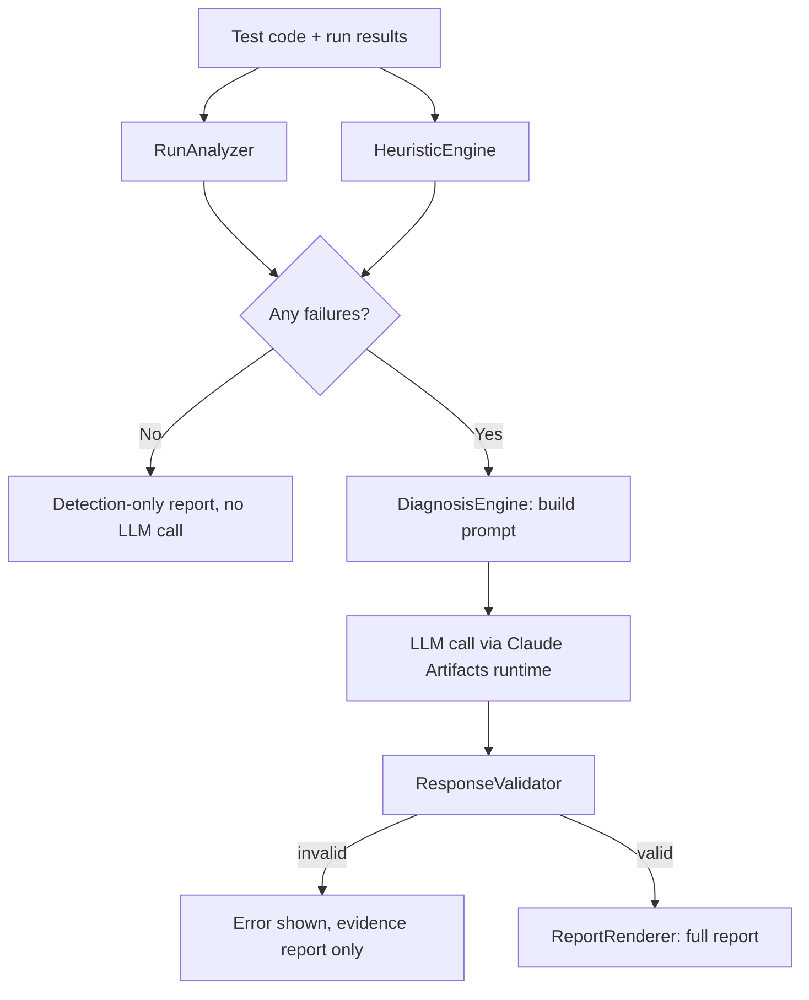

# Flaky Test Diagnosis Assistant

An actively developed QA diagnostic prototype that helps explain **why** a test is intermittently failing, not only that it is.

Given a test's source code and the results of several runs, it checks whether the pattern is genuinely intermittent, extracts structured evidence from the code, and, where AI is available, asks an LLM for a root-cause hypothesis that must be grounded in that evidence.

> **Project status: prototype.** Behavior has so far been checked only against five synthetic demo scenarios. Real-world validation is planned but **has not been done**, so accuracy and reliability on real test suites are unknown. This is not production software. See [Validation status](#validation-status) and [Implemented vs. planned](#implemented-vs-planned).

## Why this exists

When a failed test passes on retry, the build goes green but the cause is never explained. Many tools can flag a test as flaky; fewer help work out *why*. The same PASS → FAIL → PASS pattern can come from very different causes (timing, test-order dependency, environment or data, resource contention, non-deterministic assertions), and each needs a different fix. This project explores whether combining deterministic evidence extraction with a constrained LLM diagnosis can make that investigation faster, while staying honest about what is and isn't known.

## How it works

1. **Run analysis.** Lines such as `Run 2: FAIL - reason` are parsed into totals and a failure rate. A test is treated as *intermittent* only if it has both passes and failures. All-fail is reported as a consistent failure (more likely a real bug), and all-pass as "no evidence of flakiness yet". A single failure is never labeled flaky.
2. **Evidence extraction.** Regex-based detectors scan the test code and return structured records rather than booleans: `{ signal, category, source, evidence, severity }`.
3. **Evidence Score.** A simple, documented number (formula below). It is not a probability.
4. **AI diagnosis (optional).** The code, parsed runs, and extracted evidence are sent to an LLM, which is instructed to reply in a strict JSON schema and not to invent evidence.
5. **Validation.** The reply is checked for required fields and allowed confidence values. If it is invalid, an error is shown and **no fallback diagnosis is fabricated**; the evidence report still renders.
6. **Report.** Flakiness status, failure rate, extracted evidence, diagnosis (if available), alternative causes, suggested fix, and limitations.

If every run passed, the AI step is skipped, since there is nothing to diagnose.

## Implemented vs. planned

### Implemented (current prototype)

| Capability | Notes |
|---|---|
| Multi-run parsing and failure-rate calculation | Unit-tested |
| Intermittent / consistent-failure / all-pass classification | Unit-tested |
| Heuristic evidence extraction (11 signals) | Unit-tested; regex-based, JavaScript-style tests |
| Evidence Score | Formula documented below; code signals and run pattern only |
| LLM prompt construction and strict JSON schema | AI call works only inside Claude Artifacts (see [AI diagnosis and the Claude Artifacts dependency](#ai-diagnosis-and-the-claude-artifacts-dependency)) |
| Response validation with no fabricated fallback | Implemented in the app; not independently unit-tested (see [Limitations](#limitations)) |
| Report card UI | Single self-contained HTML file |
| Five labeled demo scenarios | Synthetic; in `examples/` and built into the app |
| Sync test between the app's inlined logic and `src/heuristics.js` | Guards against the two copies drifting apart |

### Planned (not implemented)

| Capability | Status |
|---|---|
| Validation on real-world flaky tests | **Planned, not started** |
| Standalone AI diagnosis (bring-your-own API key) | **Planned, not started** |
| Calibrated or empirically evaluated confidence | Planned. Current High/Medium/Low labels come from the LLM and are not validated |
| Log-based evidence signals (e.g. timestamp ordering) | Planned. Today, log text reaches the LLM but does not affect the Evidence Score |
| Evidence-grounding verification of LLM output | Planned. Today grounding is enforced by prompt instructions only |
| CI integration (GitHub Actions, Jenkins) | Planned |
| Run history, trends, and team views | Planned |
| Assisted fix suggestions with human approval | Planned |
| Evaluation with real teams | Planned, contingent on earlier phases |

## Validation status

**Current validation uses synthetic scenarios only.** The five demo scenarios were written by the author, one for each root-cause category, to exercise the pipeline. They show that the parsing, heuristics, validation, and report flow behave as designed on inputs the author chose. They do **not** show how well the tool diagnoses real flaky tests, which are messier, noisier, and often have multiple interacting causes.

Also worth knowing:

- LLM output can differ between runs of the same input, so a confidence label observed once may not repeat. Small informal experiments with modified logs have shown the response changing when the supplied evidence changes, but these used simulated logs and are not a measurement of accuracy.
- Confidence labels are not calibrated, and no accuracy, precision, or recall figures are claimed.
- **Real-world validation is planned** (see the [roadmap](#roadmap)). Until it is done, treat the output as a hypothesis to investigate, not a verdict.

## AI diagnosis and the Claude Artifacts dependency

The AI diagnosis step calls `claude.use('sample')`, a runtime capability that exists **only when the page is hosted as a Claude Artifact** and opened in the Claude viewer with the `sample` capability declared at publish time. It is not a standard browser feature and is not an API key integration.

What this means in practice:

| Where you run it | Run analysis, evidence, Evidence Score | AI diagnosis |
|---|---|---|
| Hosted as a Claude Artifact, viewed in Claude | Works | Intended to work, subject to Claude's platform availability and limits |
| Opened locally as a plain HTML file | Works | **Does not work.** When a run has failures, an error is shown and the evidence report still renders. No fake diagnosis is produced |

Consequences to be aware of:

- Anyone cloning this repository can use everything except the AI step, unless they supply their own LLM client.
- The AI step depends on a third-party platform feature whose availability and behavior are outside this project's control.
- The LLM call is isolated in the `DiagnosisEngine` module, which is where a standalone integration would be added (see roadmap, Phase 2).

No API keys or environment variables are required or present in this repository, so there is no `.env.example`.

<!-- Add the live Claude Artifact link here once you have confirmed it runs correctly in your own browser session. -->

## Evidence Score

```
score = Σ severity_weight(evidence)   (high = 3, medium = 2, low = 1)
      + 2 if runs are intermittent (mixed pass/fail)
      + 1 if 5 or more runs were provided
```

It summarizes structural risk signals in the code plus the strength of the run pattern. It does not read log content and is **not** a calibrated probability.

## Heuristic signals

`fixed_wait`, `missing_await`, `hardcoded_date`, `random_value`, `unsorted_collection_assertion`, `shared_global_state`, `test_order_assumption`, `shared_resource`, `database_dependency`, `external_network_call`, `parallel_execution_risk`.

These flag *risk*, not proof. They are line-level pattern checks and can produce both false positives and false negatives.

## Example scenarios

Five **demo** scenarios live in `examples/`. They are synthetic and are not real production data. Each has test code (`*.test-code.js`) and run results (`*.runs.txt`); `scenarios.json` lists the heuristic evidence each one triggers.

| Scenario | Intended category | Runs failed | Heuristic signal(s) |
|---|---|---|---|
| `timing` | Timing / race condition | 2 / 5 | `fixed_wait` |
| `order` | Test-order dependency | 2 / 5 | `test_order_assumption` |
| `environment` | Environment / data dependency | 2 / 5 | `hardcoded_date` |
| `resource` | Resource contention | 2 / 5 | `shared_resource` (x2), `external_network_call` |
| `assertion` | Non-deterministic assertion | 3 / 3 | `random_value` |

The `assertion` scenario fails on every run, so the app classifies it as a **consistent failure**, not intermittent. That is the tool's intended behavior, but it means this scenario demonstrates the heuristic signal rather than an intermittent pattern.

## Running it locally

**Requirements:** a modern browser, and Node.js 18+ for the tests. Nothing to install.

```bash
git clone <your-repo-url>
cd flaky-test-diagnosis-assistant

# Run the tests
npm test        # or: node tests/heuristics.test.js && node tests/sync.test.js

# Open the app
open flaky-test-diagnoser.html          # macOS; or double-click the file
# optional local server:
python3 -m http.server 8000             # visit http://localhost:8000/flaky-test-diagnoser.html
```

Locally you get run analysis, evidence extraction, the Evidence Score, and the demo scenarios. The AI diagnosis requires the Claude Artifacts environment (see above).

## Project structure

```
flaky-test-diagnoser.html   Single-file app: RunAnalyzer, HeuristicEngine, DiagnosisEngine,
                            ResponseValidator, ReportRenderer, DEMOS
src/heuristics.js           Standalone copy of the heuristic and run-parsing logic (for testing)
tests/heuristics.test.js    Unit tests for heuristics and run parsing
tests/sync.test.js          Checks the HTML's inlined logic matches src/heuristics.js
examples/                   The five synthetic demo scenarios
```

The app is a single HTML file because it was built to be hosted as one self-contained page. `src/heuristics.js` exists so that logic can be unit-tested in Node.

## Architecture



### Expected LLM response

```json
{
  "diagnosis": {
    "category": "timing | order | environment | resource | assertion | other",
    "summary": "...",
    "evidence": ["..."],
    "reasoning": "...",
    "confidence_level": "High | Medium | Low",
    "suggested_fix": "...",
    "code_example": "..."
  },
  "alternative_causes": ["..."]
}
```

## Limitations

- **No real-world validation yet.** Synthetic scenarios only; accuracy on real flaky tests is unknown.
- **LLM variability.** Output can differ between runs, and confidence labels are uncalibrated.
- **Grounding is prompt-enforced, not verified.** The validator checks response shape and allowed values; it does not check that the cited evidence matches the extracted evidence.
- **Heuristics are regex-based** and aimed at JavaScript-style tests. They will miss patterns and can misfire.
- **The Evidence Score ignores log content,** so it does not change when different logs are supplied.
- **Validator test coverage.** `tests/heuristics.test.js` includes a test that checks the expected required-field list, but it does not call the app's actual `ResponseValidator` (which lives inside the HTML). Treat validator behavior as manually checked, not unit-tested.
- **AI step depends on Claude Artifacts** and does not run in a plain local copy.
- Manual paste-in only. No CI integration, persistence, or history.
- Not production-ready, and not a replacement for investigating a failure yourself.

## Roadmap

Phases are ordered by dependency, not by committed dates. Later phases depend on the results of earlier ones.

### Phase 1: Real-world validation

Goal: find out how the tool actually performs, and report the result honestly, including where it fails.

- Collect real flaky tests and their run histories from public sources (for example, open-source projects' CI histories and documented flaky-test fixes).
- Establish ground truth where possible, using tests whose root cause was later confirmed by a fix or maintainer discussion, and record the source for each case.
- Evaluate the heuristics alone: how often each signal fires correctly, and its false-positive and false-negative behavior.
- Evaluate the LLM diagnosis against ground truth, repeating each case several times to measure run-to-run variability.
- Compare heuristics-only against heuristics plus LLM, to learn whether the AI layer adds value.
- Publish results, including failures and limitations, in this repository.

### Phase 2: Standalone AI functionality

Goal: remove the dependency on the Claude Artifacts runtime.

- Add a provider-agnostic LLM client inside `DiagnosisEngine`, configured through environment variables (an `.env.example` will be added at that point).
- Extract `ResponseValidator` into its own module with real unit tests.
- Add verification that cited evidence in the LLM's output actually appears in the extracted evidence.
- Add log-based evidence signals, and make the Evidence Score respond to them.
- Package so it runs from a command line or a small local server, not only from a browser tab.

### Phase 3: Company evaluation (future, contingent on Phases 1 and 2)

Goal: learn whether this helps real QA teams, if the earlier results justify it.

- Pilot with consenting teams on their own flaky tests, using read-only or anonymized data and respecting their privacy and security requirements.
- Define success criteria up front (for example, time to identify a root cause compared with their current process, and diagnosis usefulness as judged by the engineers).
- Add CI integration (GitHub Actions first) and run history only as the pilot shows they are needed.
- Treat assisted fix suggestions as human-approved only; no automatic merging.

No timelines or outcomes are promised for any phase.
